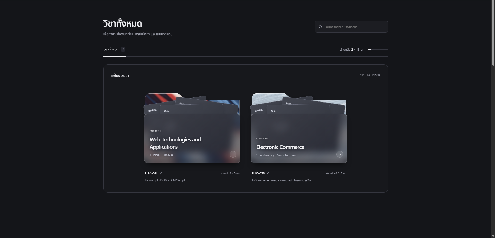
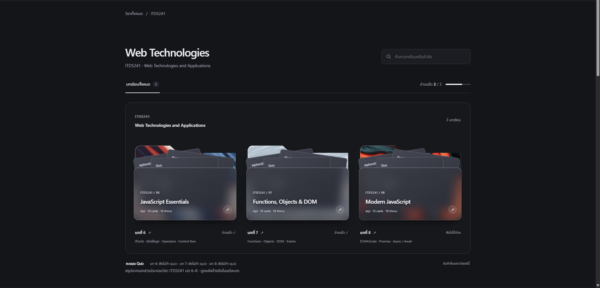

# Study Garden

Study Garden คือเว็บไซต์สำหรับทบทวนบทเรียนและเตรียมสอบ รวมสรุปภาษาไทย กิจกรรมฝึกคิด Flashcards และ Quiz พร้อมเฉลยไว้ในที่เดียว

เหมาะสำหรับคนที่อยากอ่านทบทวนทีละหัวข้อ ฝึกจำคำศัพท์ หรือทดสอบความเข้าใจก่อนสอบ เลือกวิชาและเริ่มเรียนผ่านเว็บไซต์ได้ทันที

[เข้าใช้งานเว็บไซต์](https://title5656.github.io/study-garden/) · [GitHub](https://github.com/Title5656/study-garden)

## ตัวอย่างหน้าจอ

### หน้ารวมวิชา — เลือกวิชาที่ต้องการทบทวน

ค้นหาวิชาจากรหัสหรือชื่อวิชา เปิดแฟ้มเพื่อเลือกบทเรียน และดูความคืบหน้าการอ่านของแต่ละวิชา

### หน้ารายวิชา — เลือกบทเรียนและดูความคืบหน้า

เลือกบทเรียนจากแฟ้มแต่ละบท พร้อมดูสถานะอ่านแล้วและสรุปคะแนน Quiz ของวิชานั้น

## ฟีเจอร์หลัก

- ค้นหารายวิชาและบทเรียนจากรหัส ชื่อ หรือหัวข้อที่ต้องการทบทวน
- อ่านสรุปภาษาไทยทีละหัวข้อ พร้อมตัวอย่าง ตารางเปรียบเทียบ และคำถามทบทวน
- ทดลองกิจกรรมในบทเรียนเพื่อฝึกความเข้าใจด้วยตัวเอง
- ทบทวนคำศัพท์และแนวคิดสำคัญด้วย Flashcards ที่กดพลิกดูคำตอบได้
- ทำ Quiz ท้ายบท พร้อมคะแนน เฉลย และคำอธิบายหลังตรวจคำตอบ
- ทำแบบทดสอบซ้ำได้ พร้อมเก็บคะแนนล่าสุดและคะแนนสูงสุดแยกตามบท
- ทำเครื่องหมายว่าอ่านแล้ว และติดตามความคืบหน้าแยกตามรายวิชา
- สลับโหมดสว่างและโหมดมืด พร้อมใช้งานทั้งบนคอมพิวเตอร์และมือถือ

## รายวิชาที่เปิดให้อ่าน

ปัจจุบันมี 2 วิชา รวม 13 บทเรียน พร้อม Flashcards 132 ใบ และ Quiz 130 ข้อ

| วิชา | เนื้อหา | บทเรียน | Flashcards | Quiz |
| --- | --- | --- | --- | --- |
| [ITDS241 · Web Technologies and Applications](https://title5656.github.io/study-garden/subjects/itds241/) | บทที่ 6–8: JavaScript Essentials, Functions, Objects & DOM และ Modern JavaScript | 3 บท | 32 ใบ | 30 ข้อ |
| [ITDS294 · Fundamentals of Electronic Commerce Systems](https://title5656.github.io/study-garden/subjects/itds294/) | พาณิชย์อิเล็กทรอนิกส์ การตลาดออนไลน์ กรณีศึกษา และแบบฝึกโครงงานธุรกิจ | 10 บท | 100 ใบ | 100 ข้อ |

ITDS294 แบ่งเป็นสรุปเนื้อหา 7 บท และ Lab โครงงาน 3 บท มีแบบฝึกเรื่องโมเดลธุรกิจ การวางแผนธุรกิจ เส้นทางลูกค้า และการคำนวณตัวชี้วัดการตลาด พร้อมตัวอย่างประกอบให้ลองทำตาม

## วิธีใช้งาน

1. เปิด [Study Garden](https://title5656.github.io/study-garden/) แล้วเลือกวิชาที่ต้องการทบทวน หรือค้นหาด้วยรหัสวิชาและชื่อวิชา
2. เลือกบทเรียนที่ต้องการจากแฟ้มรายวิชา
3. อ่านสรุปและทำกิจกรรม โดยเลือกหัวข้อจากสารบัญ หรือกด **หัวข้อถัดไป** เพื่ออ่านตามลำดับ
4. เปิด **Flashcards** แล้วกดพลิกการ์ดเพื่อทบทวนคำศัพท์และแนวคิดสำคัญ
5. ทำ **Quiz** ให้ครบทุกข้อ แล้วกด **ตรวจคำตอบ** เพื่อดูคะแนน เฉลย และคำอธิบาย
6. กด **ทำเครื่องหมายว่าอ่านแล้ว** เพื่อบันทึกความคืบหน้า แล้วกลับไปเลือกบทเรียนหรืออ่านบทถัดไป

## ใช้ทบทวนให้เหมาะกับตัวเอง

- **อ่านก่อนสอบ:** เลือกหัวข้อที่ยังไม่มั่นใจ อ่านสรุปและตัวอย่าง แล้วทำ Quiz เพื่อตรวจความเข้าใจ
- **ทบทวนคำศัพท์:** เปิด Flashcards ลองตอบด้วยตัวเองก่อนพลิกดูคำอธิบาย แล้วเลื่อนไปใบถัดไป
- **ฝึกจากข้อที่ตอบผิด:** อ่านเหตุผลในเฉลย กลับไปทบทวนหัวข้อนั้น แล้วทำ Quiz ใหม่ได้
- **ฝึกทำโครงงาน:** เปิด Lab ของ ITDS294 ลองกรอกใบงาน และบันทึกร่างหรือดาวน์โหลดคำตอบเก็บไว้

## การบันทึกและข้อควรรู้

- เริ่มใช้งานได้โดยไม่ต้องสมัครสมาชิก
- คะแนนและความคืบหน้าเก็บไว้ในเบราว์เซอร์ที่ใช้งาน กลับมาเปิดด้วยเครื่องและเบราว์เซอร์เดิมเพื่อเรียนต่อ
- ข้อมูลไม่ซิงก์ข้ามเครื่องหรือเบราว์เซอร์ และอาจหายเมื่อคุณล้างข้อมูลเว็บไซต์
- หากเบราว์เซอร์ไม่อนุญาตให้บันทึกข้อมูล เว็บไซต์จะแจ้งเตือนว่าความคืบหน้าอาจไม่ถูกเก็บหลังปิดหน้า
- Quiz เป็นแบบฝึกทบทวนพร้อมคำอธิบาย ไม่ใช่ข้อสอบจริง
- ดูแหล่งอ้างอิงของเนื้อหาได้ภายในแต่ละบทเรียน

## ลิงก์

- [เข้าใช้งาน Study Garden](https://title5656.github.io/study-garden/)
- [GitHub Repository](https://github.com/Title5656/study-garden)
- [แจ้งปัญหาหรือเสนอแนะ](https://github.com/Title5656/study-garden/issues)
